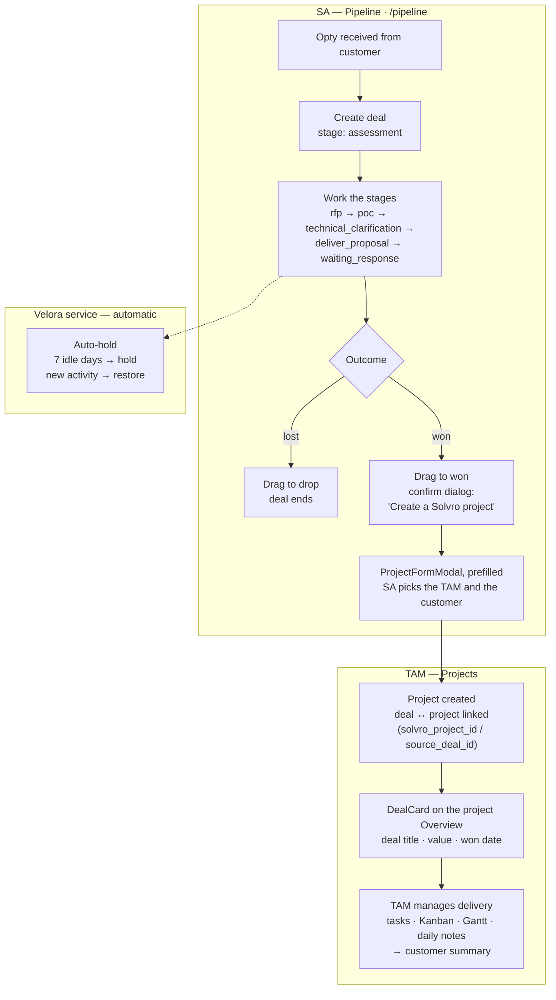

# PRD — Velora Integration into Solvro

> **PIVOT 2026-08-14: the architecture half of this PRD is SUPERSEDED.** The user redefined the integration as a **native port** — Velora's features re-implemented inside the Solvro repo (Prisma/Express/React), no separate backing service. Still valid as feature spec: §0 (lifecycle), §2 (UI/UX), §5 (permissions mapping, minus the token-array mechanics), §6 guardrails 1–3/6–7. Void: §3 (API contract — no `/pipeline-api`, no two verifiers), §4 (topology — no second service/database), §7 (delivery mapping). Phase 1's infra was reverted (PR #148).

**Status:** **APPROVED in full — 2026-08-14** (user review, section by section; every §8 question settled). Implementation plan: `docs/plans/velora-integration-plan.md`.
**Companion doc:** the file-level rewrite plan (artifact "Velora → Solvro: The Rewrite Plan"). That doc says *which files* die or get rewritten; this PRD says *what gets built* and *how it must behave*.
**Source repos:** Solvro (this repo, GitHub) · VeloraApp (`FS3P/VeloraApp`, GitLab mirror on GitHub). All Velora facts below were extracted from Velora source, not from memory.

---

## 0. Summary

Velora is a sales-opportunity Kanban tracker (Next.js 14, raw `pg`, own Postgres) used by the Solution Architect team. We integrate it into Solvro as a **Pipeline module**: every Velora screen is deleted or rewritten as thin Solvro pages over the vendored ReUI machinery; Velora's backend survives as a **headless API service** behind the same reverse proxy. Solvro becomes the single UI, the single sign-in, and the single place to manage users and roles.

End state:

- **Solvro frontend** owns all UI: Pipeline board (4 views), opportunity detail, admin tabs, Excel import, analytics fold-ins.
- **Velora service** keeps: its 53 surviving API routes, its Postgres, and the auto-hold cron. **External notifications (Telegram / Google Chat) and their crons (deadline reminder, weekly report) are disabled for v1** — deferred by user decision 2026-08-14, code retained in the service but not scheduled.
- **One JWT** (Solvro-issued) authenticates both. Velora never issues tokens again.
- **Won deal → Solvro project** handoff links the two domains.

Delivery follows the rewrite plan's seven batches (B1–B7, ~10–12 weeks). This PRD is the spec for B2–B7.

### 0.1 The opty-to-project lifecycle

From the SA receiving an opportunity to the TAM managing the delivered project:



The TAM never watches the pipeline: the won deal arrives as a normal Solvro project carrying its sales context on the `DealCard`. A TAM without `pipeline:view` reads the card's facts; the link back to `/pipeline/:id` works only for pipeline users.

---

## 1. Decisions required before implementation (user-owned)

> **All four settled 2026-08-14** (user review, session "Velora Integration Plan"):

1. **Product boundary — SETTLED.** Root `CLAUDE.md`'s Product block gets rewritten: Solvro serves TAMs (delivery) and SAs (pipeline); the TAM daily-notes loop remains the core loop. Drafted by the orchestrator, applied only on user approval (user-owned block).
2. **Stage tones — SETTLED (Q1).** The six sanctioned chip tones with duplicates (§2.2). No DESIGN.md change.
3. **Handoff orchestration — SETTLED (Q2).** Frontend-orchestrated (§4.4). No `serviceAuth.ts`, no service-token model in v1.
4. **Customer linking — SETTLED (Q3).** Soft-match: `customer_name` stays free text; the UI suggests matching `Customer` rows while typing and at handoff. No cross-database FK in v1.

---

## 2. UI/UX specification

> **APPROVED 2026-08-14** (user review, one pass — with Q4/Q6/`xlsx` settled and the v1 notification drop folded in).

> Binding references: `docs/DESIGN.md` (Technical Precision — dark-first, 1px borders, no shadows outside the whitelist, Material Symbols icons, Source Sans 3), `frontend/CLAUDE.md` (optimistic mutations, `apiRequest`, Base-UI, 375px floor). Everything below is expressed against those rules; no Velora CSS, no Velora primitives, no `@hello-pangea/dnd`, no `lucide-react` in app code.

### 2.1 Information architecture

New top-level section **Pipeline** in the sidebar, between Customers and Daily Review:

```
NAV_COMMANDS additions (frontend/src/lib/navCommands.ts):
  { to: "/pipeline",  label: "Pipeline",  icon: "filter_alt", requires: "pipeline:view" }
```

Routes (all in `App.tsx`, guarded by `AuthGuard` + permission):

| Route | Page | Content |
|---|---|---|
| `/pipeline` | `pages/Pipeline.tsx` | KPI bar + view switcher + active view |
| `/pipeline/:id` | `pages/OpportunityDetail.tsx` | one deal, full page |
| `/admin` (existing) | `pages/Admin.tsx` | + 5 new tabs (§2.8) |
| `/executive` (existing) | `pages/Executive.tsx` | + Pipeline analytics panels (§2.7) |
| `/overview` (existing) | `pages/Overview.tsx` | + Pipeline summary panel (§2.7) |

Both sidebar and ⌘K palette pick this up automatically from `NAV_COMMANDS`. **`requires` only hides the nav entry — it does not block direct URL access.** The `/pipeline` routes therefore get a real guard: `components/PipelineGuard.tsx`, a mirror of `ExecutiveGuard.tsx`, checking `hasPermission(user, "pipeline:view")`. The view switcher state persists to `localStorage["solvro.pipeline.view"]` (mirrors Velora's `velora-board-view` behavior, renamed to the `solvro.*` key convention).

### 2.2 Design-language mapping (Velora → Technical Precision)

**Stages.** Velora's canonical list (from `lib/utils.ts` `STAGES`), preserved verbatim as ids + labels:

`assessment` → Assessment · `rfp` → RFP · `poc` → PoC · `technical_clarification` → Technical Clarification · `deliver_proposal` → Delivered Proposal · `waiting_response` → Waiting Response · `won` → Won · `drop` → Drop · `hold` → Hold

**Stage chip tones** — a new `StageChip` in the bespoke-chip family (sibling of `StatusChip`/`PriorityBadge`; never rebased onto `reui/badge` per the standing decision). Tones come from the sanctioned six only:

| Stage | Tone | Rationale |
|---|---|---|
| `assessment` | `gray` | entry state, like `TODO` |
| `rfp`, `poc`, `technical_clarification` | `blue` (renders green-tinted `bg-primary/10 text-primary`) | in-motion states, like `IN_PROGRESS` |
| `deliver_proposal` | `amber` | ball in customer's court soon |
| `waiting_response` | `violet` | passive wait |
| `won` | `emerald` | terminal success, like `DONE` |
| `drop` | `rose` | terminal loss, like `CANCELLED` |
| `hold` | `amber` + `pause` icon glyph | parked; icon disambiguates from `deliver_proposal` |

Stage identity on the board comes primarily from the **column label** (`text-label-caps` header), not the chip color — duplicate tones are acceptable. Chips carry the identity only on List view rows and the detail page.

**Money.** Velora is IDR: `formatCurrency` (full `Rp 500.000.000`) and `formatCurrencyCompact` (`Rp 500jt`, `Rp 1,2M`). Port both helpers into `frontend/src/lib/pipelineFormat.ts` unchanged in behavior. Numerics render `text-data-mono`.

**Dates.** Velora shows `id-ID` short dates (`30 Jun 2026`). Keep that format in Pipeline surfaces. Forms use Solvro's `DateField` (plain `"yyyy-MM-dd"` contract — `deadline`/`request_date` are DATE columns, so no instant-conversion; this stays out of `lib/dateField.ts`'s ISO-instant path).

**Win probability badge** (generic `Chip` tones, banding from Velora's `getProbabilityColor`): ≥ 70 `emerald` · 40–69 `amber` · < 40 `rose`.

**Deadline urgency badge** (from Velora's `deadlineBadge`): ≤ 3 days `rose` + `warning` icon · ≤ 7 days `amber` · else plain `on-surface-variant` date text.

**Icons.** Material Symbols Outlined throughout: `filter_alt` (pipeline), `person` (PIC), `event` (deadline), `pause_circle` (hold), `trophy`/`check_circle` (won), `block` (drop), `history` (activity), `link` (links), `upload_file` (import).

**Dark-first.** Every new surface is designed against the dark palette first; Velora's light-only Tailwind-3 colors (`bg-blue-100` etc.) are never ported.

### 2.3 Pipeline board — `/pipeline`, Kanban view

Layout (desktop):

```
┌ KPI bar ────────────────────────────────────────────────────────────┐
│ [Total Pipeline] [Deadline ≤7d] [Won this month] [Active PICs]      │
│ [funnel strip: per-stage counts, clickable → scrolls to column]     │
├ Toolbar ────────────────────────────────────────────────────────────┤
│ [Search customer/title] [PIC filter] [view: Kanban|List|Swim|Qtr]   │
│                                              [Import] [+ Opportunity]│
├ Board (horizontal scroll) ──────────────────────────────────────────┤
│ ASSESSMENT │ RFP │ POC │ TECH CLAR. │ DELIVERED │ WAITING │ WON │ … │
│  ┌card┐    │     │     │            │           │         │     │   │
└─────────────────────────────────────────────────────────────────────┘
```

**Engine.** The vendored `reui/kanban.tsx` engine directly, with a new thin layer `frontend/src/components/pipeline/` (adapter + commit mapper + `SolvroPipelineKanban.tsx` container + `OpportunityCard`). `kanban-v2/adapter.ts` is hard-typed to `TaskStatus` (`TODO/IN_PROGRESS/DONE`) and is **not** reused — its *pattern* is copied as typed parallels, per kanban-v2's own stated "copy, don't extract" policy (its card file documents the duplication as permanent/intentional): pure projection `Opportunity[] → Record<Stage, Opportunity[]>`, all 9 columns always present, filtering hides cards without touching order, drop math (`commitMapper`'s neighbor-based position resolution + no-op guards) runs on the unfiltered list. `SolvroKanban.tsx`'s "live during drag, query-derived at rest" drag-state machine and its mobile swipeable-columns pager are the container patterns to copy. Column order within a stage = `stage_order` ascending, id tiebreak.

**KPI bar** (exact metrics from Velora's `kpi-bar.tsx`, restyled as Executive-style stat tiles — `surface-container` + 1px `outline-variant`, no shadows, no emoji icons → Material Symbols):

1. **Total Pipeline** — Σ `deal_value` of active deals (stage ∉ {won, drop}), compact IDR; sub-line "N active".
2. **Deadline ≤ 7 days** — count; sub-line "N critical (≤ 3d)" in `rose` when > 0.
3. **Won this month** — Σ value + count, read from `won_at` (new column, Q4 settled — replaces Velora's `updated_at` proxy).
4. **Active PICs** — distinct `pic_id` among active deals.
5. **Funnel strip** — per-stage counts excluding `drop`, rendered as a compact segmented bar.

**Card anatomy** (from Velora's `card.tsx`, restyled): title (2-line clamp, `text-sm` semibold) · win% `Chip` top-right · customer (`text-xs on-surface-variant`) · deal value (compact IDR, `text-data-mono text-primary`) · PIC + deadline row (icon + `text-xs`) · product/solution (truncated). Hold cards additionally show `pause_circle` + "held from {pre_hold_stage label}". Card click → `/pipeline/:id`. Drag = stage change; the drag overlay uses `shadow-overlay` (already whitelisted for Kanban drag state).

**Drag rules.** Any column → any column (Velora imposes no transition constraints; permission-gated: needs `pipeline:edit_own` on own deal or `pipeline:edit_all`). Drop into `won`/`drop` asks for confirmation via `ConfirmModal.tsx` (destructive-ish, terminal). Drop into `won` additionally offers the handoff (§2.10). Stage change writes optimistically (§2.11) and the server records the activity.

### 2.4 List, Swimlane, Quarter views

All three sit on the vendored `reui/data-grid` with `tableLayout={{ dense: true }}` (the sanctioned compact mode) + `reui/filters.tsx`. Shared toolbar and KPI bar stay mounted; only the body swaps. House data-grid conventions bind: every string column declares an explicit `sortingFn` (`lib/tableSort.ts`; TanStack auto-detection is unreliable under 10 rows), pagination stays **off** app-wide (full sorted row model renders), `data:` gets a stable empty-array constant, `width: "auto"` (the SOLVRO PATCH proportional layout). The vendored virtualizer (`data-grid-table-virtual.tsx`) is unused anywhere — do not plan around it; SA-team row counts don't need it.

**List** (from `list-view.tsx`): columns **Opportunity** (title + customer stacked) · **Stage** (StageChip, sortable) · **Nilai** (right-aligned compact IDR, sortable) · **PIC** · **Deadline** (urgency badge) · **Win%** (centered chip) · **Produk** · row-hover actions (open, edit). Default sort: none (server order); sort cycle desc → asc → off.

**Swimlane** (from `swimlane-view.tsx`): one lane per PIC (avatar initials circle — deterministic per-PIC color hash is fine, but draw the 8 avatar colors from the four chip-tone text colors + `primary` + `tertiary`, not Velora's raw hexes), columns = stages minus `drop`. PIC filter chips replace the toolbar PIC dropdown in this view (Velora hides the dropdown here; keep that). Cells show mini-cards (title + value).

**Quarter** (from `quarter-view.tsx`): four fixed columns Q1–Q4 of the current year grouped by `request_date` (+ "no date" bucket). Column headers use `text-label-caps`; per-quarter accent = the four chip tones in order (blue/emerald/amber/violet). No drag in this view.

### 2.5 Opportunity detail — `/pipeline/:id`

Full page (like `ProjectDetail.tsx`), not a side panel — Velora's detail has too much content for `TaskPanel`-style overlay. Layout:

```
← Back to Pipeline        [StageChip]        [Edit] [Delete]
{title}                    {customer_name}
┌ meta grid (2×4) ────────────────┐  ┌ right rail ───────────────┐
│ Value · Win% · PIC · Deadline   │  │ LINKS  [+ Add Link]       │
│ Request date · Lead source ·    │  │  📄 label → url           │
│ Product/Solution · Created      │  │ (Google Docs icon detect) │
├ description ────────────────────┤  └───────────────────────────┘
├ ACTIVITY ───────────────────────┤
│ reui/timeline.tsx — note + author + relative time; [Add note]  │
└─────────────────────────────────┘
```

- **Edit** opens `OpportunityFormModal` (§2.6). **Delete** goes through `ConfirmModal.tsx` (do not port Velora's native `confirm()` calls).
- **Links** (Velora `documents` table: `file_name` + `file_url` — they are URL links, not uploads): add-link inline form with label + URL, URL validation, delete with confirm. Keep the Google Docs/Sheets icon detection.
- **Activity**: `reui/timeline.tsx`; entries are plain notes (`activity_logs.note`) plus system entries the server writes on stage change. Adding a note is the "touch" that resets the auto-hold clock — surface that: a muted caption under the composer on held deals: "Adding activity restores this deal from Hold."
- **Stage change from detail**: the StageChip is a menu (dropdown-menu) listing all stages — same confirm rules as drag.

### 2.6 Opportunity form (create/edit)

`components/OpportunityFormModal.tsx`, structured like `ProjectFormModal.tsx` / `TaskFormModal.tsx` (Modal, edge-to-edge on phone). Fields (from Velora `opportunity-form.tsx`, requiredness preserved):

| Field | Control | Required |
|---|---|---|
| `title` | `Input` | ✔ |
| `customer_name` | `Input` + soft-match suggestions from Solvro `Customer` (Q3) | ✔ |
| `deal_value` | numeric `Input`, IDR, `text-data-mono` | ✔ |
| `stage` | `select` of the 9 stages | default `assessment` (or the column the "+" was clicked in) |
| `pic_id` | `select` of Velora members | — |
| `request_date`, `deadline` | `DateField` | — |
| `win_probability` | numeric 0–100 | default 50 |
| `product_solution` | `Input` | ✔ |
| `lead_source` | `Input` | — |
| `description` | `Textarea` rows=3 | — |

The board's per-column "+" opens the form with `stage` prefilled (Velora's `defaultStage` behavior).

### 2.7 Dashboard fold-ins

Both fold-ins render **only for users holding `pipeline:view`** — a TAM without it sees today's pages unchanged and their browser never calls `/pipeline-api` (no 403 noise). The Executive analytics additionally sit behind the page's own `report:executive` guard.

**Overview** gains one **Pipeline** panel (data from Velora's `/api/dashboard` equivalent): three stat tiles — Total / Active / On Hold (hold count in `amber` when > 0) — plus the per-PIC summary cards (name, total, active, hold, Σ value; from `PicSummaryCards`). Card click → drill-down modal (Velora `pic-detail-modal`): the PIC's deals with `activity_status` active/hold and `last_activity_at`. Render the modal as `Modal.tsx`.

**Executive** (guard: `report:executive`) gains a **Pipeline analytics** section, Recharts (already a dependency, `recharts@^2.13.0`, today exercised only by `pages/views/ProjectOverview.tsx` — Executive itself currently renders hand-rolled divs, so this is that page's first chart-library use), Technical-Precision restyle (token colors only):

1. **Conversion funnel** (`conversion-funnel.tsx`) — per-stage counts, excluding drop.
2. **Leaderboard** (`leaderboard.tsx`) + **PIC performance table** (`pic-performance-table.tsx`) — won value/count per PIC; table goes on `reui/data-grid` dense.
3. **Trend chart** (`trend-chart.tsx`) — created/won over time.
4. **Workload heatmap** (`workload-heatmap.tsx`) — rows = PICs, columns = the 6 active stages, cell = deal count with intensity ramp; `OVERLOAD_THRESHOLD = 6`, `UNDERLOAD_THRESHOLD = 2` badges per PIC (overload `rose`, underload `amber`, normal `emerald`). Intensity ramp: `primary` alpha steps (`bg-primary/10..40`), not Velora's green/yellow/red hexes.

These panels respect `excludeFromPortfolio` semantics only for Solvro data; Velora data has no such flag.

### 2.8 Admin tabs + settings

`pages/Admin.tsx` `TAB_ITEMS` today: Users · Roles · Sign-in · Project Override. Add four (data via `pipelineApi`, admin-gated by the existing `"*"` wildcard):

| Tab | Source screen | Spec |
|---|---|---|
| **Access keys** | `api-token-manager.tsx` | External REST API tokens: table (name, created by, created at, status/revoked at), create → token shown **once** with copy affordance, revoke with confirm. |
| **Audit** | `audit-log-viewer.tsx` | `reui/data-grid` dense: time, user (name/email), action (chip colored by prefix `user.`/`opportunity.`/`settings.`/`permissions.`), entity type/id, details expander. Filters: user, action, entity_type, from/to dates. |
| **Scheduled jobs** | `cron-visibility.tsx` | Read-only `cron_logs`: job (`auto-hold` — the only scheduled job in v1), last run, checked counts, status. |
| **Import** | `import-history.tsx` + `export-backup.tsx` | Import history table (file, rows, who, when) + export/backup actions (download opportunities/activities CSV, backup JSON). |

**Dropped for v1 (user decision 2026-08-14):** the **Notices** tab — Velora's notification rules (`notification-rules.tsx`) and channel settings (`system-settings.tsx`: `telegram_bot_token`, `telegram_chat_id`, `google_chat_webhook_url`, `app_name`) are not ported while external notifications are disabled. Rebuild only with a new user decision.

Velora's **Users / Permissions / user-form / reset-password** screens are deleted, not ported — Solvro's Users and Roles tabs are the single identity surface (§5).

### 2.9 Excel import

`components/PipelineImportDialog.tsx`, `Modal.tsx`, three steps (from `import-excel-dialog.tsx`):

1. **Upload** — drop/select `.xlsx`; "Download template" generates the workbook client-side (SheetJS) with headers `Title, Company, Deal Value, Stage, PIC, Deadline, Product / Solution, Win Probability, Lead Source, Activity Log` + example row.
2. **Preview** — parsed rows in a dense grid with per-row valid/invalid status and reasons; footer button "Import N valid rows" (invalid rows are skipped, never block the batch).
3. **Done** — created/updated/skipped counts.

Upsert key: `title` + `customer_name` (Velora contract — unchanged, the server does the upsert). SheetJS (`xlsx`) becomes a new Solvro frontend dependency — flag in the PR; parsing stays client-side exactly as in Velora.

### 2.10 Won-deal handoff

When a deal enters `won` (drag, menu, or edit):

1. Confirm dialog gains a checkbox **"Create a Solvro project from this deal"** (default on).
2. If checked → `ProjectFormModal` opens prefilled: name = deal title, customer = matched `Customer` (by `customer_name`), description = "From pipeline deal: {title} — {product_solution} — Rp {value}". **`POST /projects` requires `customerId`** (Zod `createProjectSchema`; the form enforces it) — an unmatched `customer_name` forces the user to pick or create the customer in the modal before the project can exist. This is the strongest argument for Q3's soft-match linking.
3. On project create, the frontend PATCHes the deal with `solvro_project_id`; the deal detail page then shows a **"Project →"** link chip, and `ProjectDetail` Overview shows a **`DealCard`** (`components/DealCard.tsx`): source deal title, value, win date, link back to `/pipeline/:id`.

No automatic project creation without the user in the loop (v1). Idempotent: a deal with `solvro_project_id` set offers "Open project" instead of "Create project".

### 2.11 Interaction conventions & states

- **Server state**: new hooks in `src/lib/queries.ts` under a `pipelineKeys` namespace (separate from `queryKeys`/`adminQueryKeys`, same file). All Velora calls go through `src/lib/pipelineApi.ts` (§3.2) — never raw `fetch`.
- **Optimistic updates** for stage change (drag), inline edits, and hold-restore: `onMutate` cancel + snapshot + write, `onError` rollback, `onSettled` invalidate — the house pattern.
- **Loading**: `skeleton.tsx` rows/columns, no spinners on first paint; toolbar always renders.
- **Empty states**: board with zero deals → centered empty state with "+ Opportunity" CTA; per-column empties render nothing (no placeholder cards).
- **Errors**: Velora error shape `{ error: string }` surfaces inline via `reui/alert.tsx` (`<Alert variant="destructive">`), the house convention — **Solvro has no toast system** (no `sonner`/`react-hot-toast`/custom), and this PRD does not introduce one (see Q6). Permission-denied (403) renders the standard guard fallback.
- **Mobile (375px floor)**: List view is the phone experience; the Kanban/Swimlane/Quarter switcher hides behind `md:` and the board renders List below `md` (Gantt-precedent: desktop-only engine, list fallback). KPI bar collapses to a 2×2 tile grid (Velora already does this).
- **⌘K**: Pipeline registers via `NAV_COMMANDS` (§2.1). No new keyboard shortcuts in v1.
- **Auto-hold transparency**: held cards show the held-from label (§2.3); the deal detail shows the restore hint (§2.5). The 7-day threshold itself stays server-side in Velora's cron.

---

## 3. API contract

> **APPROVED 2026-08-14.** Governing principle (user, applies to every remaining choice in this program): **Velora is integrating into Solvro, so Velora follows Solvro's settings** — auth mechanism, secrets, conventions. Velora never brings its own variant of something Solvro already has.

### 3.1 Authentication — one token, two verifiers

- Solvro issues the JWT (`backend/src/http/auth.ts`): payload `{ sub: number, role: string, permissions: string[] }`, HS256, `env.JWT_SECRET`, expiry `env.JWT_EXPIRES_IN`. `"*"` in `permissions` grants everything.
- Velora gains `lib/solvro-token.ts`: verify HS256 with the **same `JWT_SECRET`** (shared via env on the box; single secret, single rotation), reject expired/malformed, map `sub` → `profiles.solvro_user_id`, and expose `{ userId, role, permissions }` to route handlers. Velora's own `app/api/auth/*`, `lib/permissions.ts` DB lookups, and login UI are deleted.
- The frontend sends the same bearer from `localStorage["solvro.token"]` to both APIs.
- **Permission check replacement (the "one-line edit in 53 routes")**: `hasPermission(role, "opportunity:edit_all")` (async DB) becomes `tokenHas(payload, "pipeline:edit_all")` (sync array check, `"*"` honored). Ownership checks (`pic_id === userId`) compare against the mapped Velora profile id.

### 3.2 Frontend client — `src/lib/pipelineApi.ts`

Mirror of `apiRequest<T>`: base `/pipeline-api` (nginx proxies to the Velora container), bearer attached, JSON in/out, throws on `{ error }` with status. Velora route paths keep their current shapes under the new prefix (e.g. `GET /pipeline-api/opportunities`, `PATCH /pipeline-api/opportunities/:id`, `GET /pipeline-api/dashboard`, admin: `/pipeline-api/admin/...`). No response-shape changes in v1 — the client adapts, the service does not.

### 3.3 Pagination & filtering

Velora's list endpoints return full sets (SA-team scale: hundreds of deals). v1 keeps that; client-side filter/sort (as Velora does today). Revisit only if the payload exceeds ~2k deals.

### 3.4 External REST API

`/api/external/v1/opportunities` (SHA-256-hashed bearer tokens in Velora's DB) is untouched; the Access-keys admin tab manages it. It never accepts Solvro JWTs.

---

## 4. Data & architecture end state

> **APPROVED 2026-08-14**, with one consolidation: **one Postgres server**. Solvro's existing Postgres container hosts a second database `velora`; Velora's standalone `db` container is removed.

### 4.1 Topology

One nginx: `/` → Solvro frontend, `/api` → Solvro backend, `/pipeline-api` → Velora (127.0.0.1:3001). **One Postgres server** (user decision 2026-08-14): Solvro's existing Postgres container gains a second database `velora`; Velora's `DATABASE_URL` points at it, its standalone `db` container is removed, and its data moves in at B1 via dump/restore. It stays a *separate logical database* — Velora's `users`/`audit_logs`/`settings` table names collide with Solvro's, and Prisma's migrations must never share a database with Velora's `migrate.ts`. Velora's cron container stays, scheduling **only the auto-hold job** (`/pipeline-api/cron/auto-hold` with `CRON_SECRET` — unchanged mechanism; the deadline-reminder and weekly-report entries are removed from the crontab). `setup.sh` + `nginx.conf` + compose changes are batch B1 (spine files).

### 4.2 Schema deltas

| Side | Change |
|---|---|
| Velora | `profiles.solvro_user_id INT UNIQUE NULL` — identity link, backfilled once by email match (B3) |
| Velora | `opportunities.solvro_project_id INT NULL` — handoff link |
| Velora | `opportunities.won_at TIMESTAMPTZ NULL` — set on transition into `won`, cleared on leaving it (Q4) |
| Velora | drop `users.password_hash` usage (users table retained read-only until B4 cleanup) |
| Solvro | `Project.sourceDealId String? @map("source_deal_id")` — reverse link for `DealCard` |

`schema.prisma` is a spine file → instant review on that migration.

### 4.3 Identity & lifecycle

Solvro is the source of truth for people. Creating an SA user happens in Solvro Admin → Users; a matching Velora `profiles` row is created lazily on that user's first Pipeline write (or via a small sync endpoint — implementor's choice, spec'd at task time). Deactivating a Solvro user (`active = false`) blocks token issuance, which blocks Velora too — no propagation needed. Velora's approval-workflow (pending users) dies with its auth.

### 4.4 Handoff (recommended: frontend-orchestrated)

The flow in §2.10 needs **zero machine-to-machine auth**: the browser holds one token valid on both APIs and performs `POST /api/projects` then `PATCH /pipeline-api/opportunities/:id` (set `solvro_project_id`) — with a compensating "unlink" if the second call fails. Alternative (rejected for v1): Velora calls Solvro server-side, requiring `backend/src/http/serviceAuth.ts` and a service-token model. Revisit only when automation (auto-create on webhook) is wanted.

---

## 5. Permissions mapping

> **APPROVED 2026-08-14.**

Velora's `role_permissions` table and admin/manager/member roles are deleted. Velora's 11 permission keys map into Solvro `Role.permissions` (JSONB string array):

| Velora key | Solvro permission |
|---|---|
| `opportunity:view` | `pipeline:view` |
| `opportunity:create` | `pipeline:create` |
| `opportunity:edit_own` / `edit_all` | `pipeline:edit_own` / `pipeline:edit_all` |
| `opportunity:delete_own` / `delete_all` | `pipeline:delete_own` / `pipeline:delete_all` |
| `admin:access`, `admin:manage_users`, `admin:manage_settings`, `admin:view_audit_log`, `admin:manage_permissions` | covered by Solvro's `"*"` admin wildcard — not ported as distinct keys |

Role assignment: Solvro's built-in roles are `SA`, `TAM`, `ADMIN`, `STAKEHOLDER`, `PENDING` (`BUILTIN_ROLES`, authorization is permission-string-based, never role-name-based). Grant `pipeline:view/create/edit_own/delete_own` to the existing **SA** role; create one new role **SA Manager** adding `pipeline:edit_all`/`pipeline:delete_all` — no "SA Member" invention needed. Registration points: append the new strings to `PERMISSION_CATALOG` in `frontend/src/lib/auth.tsx` (so the Admin → Roles tab can offer them) — nothing else frontend-side; Velora-side enforcement reads them from the token (§3.1). UI gating uses the same strings (`requires: "pipeline:view"` in nav; buttons check `has("pipeline:edit_all")` etc.). Deal *visibility* is not per-user scoped (matches Velora: ownership gates edit/delete, never view) — no new `visibility.ts` logic.

---

## 6. Guardrails binding on this work

> **APPROVED 2026-08-14.**

1. **No new drag/board/Gantt npm packages.** `@hello-pangea/dnd` never enters Solvro; the board uses vendored `reui/kanban.tsx` + the sanctioned dnd-kit set.
2. **No Radix.** Velora's shadcn-pattern primitives are not ported; Solvro `ui/*` (Base-UI) only.
3. **Chips stay bespoke.** `StageChip` joins `StatusChip`/`PriorityBadge` as hand-built; never rebased onto `reui/badge`.
4. **Spine touches** in this program: `nginx.conf`/`setup.sh`/docker+env (B1), `schema.prisma` + migration (B3/B7), `lib/queries.ts` (pipeline hooks), vendored `reui/` (only if patched — mark `// SOLVRO PATCH`). Each triggers an instant opus review.
5. **INTERNAL-notes export guardrail** is untouched — Pipeline adds no export surface. (`frontend/src/lib/export/` itself was deleted 2026-08-03 with the Reports page; the `NoteVisibility` contract remains binding on any future export surface, including a hypothetical "deal summary to customer" — greenfield, out of scope here.)
6. **CHANGELOG discipline** applies to every batch; new deps (`xlsx`) get called out explicitly.
7. New dependencies: **`xlsx` (SheetJS)** — the only one this PRD introduces; **approved by the user 2026-08-14**. Install runs inside the container (lock-file trap).

---

## 7. Delivery mapping

> **APPROVED 2026-08-14.** Expanded into phases in `docs/plans/velora-integration-plan.md`.

| Batch (rewrite plan) | Repo(s) | Solvro pipeline shape |
|---|---|---|
| B1 one address | infra (`nginx.conf`, `setup.sh`, compose) | 1 phase, spine review, no Velora code |
| B2 shared sign-in | Velora (GitLab) | Velora-side phase; Solvro untouched |
| B3 linked identities | Velora migration + one-off backfill script | small phase |
| B4 shared permissions | Velora (53-route edit) + Solvro seed roles | Velora phase + tiny Solvro PR |
| B5 delete project module | Velora | deletion PR, do early |
| B6 screens | Solvro (`frontend/src`) | **3 phases**: (1) Pipeline board + views + form, (2) detail + import, (3) admin tabs + analytics fold-ins. Parallel waves per the roster; phase = branch = PR into `develop` |
| B7 handoff | both (Solvro migration + `DealCard`, Velora `solvro_project_id`) | 1 phase, spine review (schema) |

**Testing.** Velora-side: its existing patterns (out of Solvro's gates). Solvro-side: vitest for the pipeline adapter/commit-mapper projections and `pipelineFormat` helpers; Playwright e2e for board drag, view switching, form, and import — **against a mocked `/pipeline-api`** (Playwright `route()` fixtures; no Velora container in Solvro CI). `gates.sh` runs unchanged. A thin cross-service smoke (login → board → drag) runs manually on the VPS staging after B6, before B7.

---

## 8. Open questions

1. ~~**Q1 — Stage tones**~~ **SETTLED 2026-08-14**: 6-tone mapping with duplicates (§2.2).
2. ~~**Q2 — Handoff orchestration**~~ **SETTLED 2026-08-14**: frontend-orchestrated (§4.4).
3. ~~**Q3 — Customer linking**~~ **SETTLED 2026-08-14**: soft-match with inline link affordance; no hard FK in v1.
4. ~~**Q4 — Won-date**~~ **SETTLED 2026-08-14**: add `opportunities.won_at TIMESTAMPTZ NULL` (set on transition into `won`, cleared on leaving it); the "Won this month" KPI reads it.
5. ~~**Q5 — Weekly report & notification templates**~~ **MOOT 2026-08-14**: external notifications (Telegram / Google Chat), the deadline-reminder cron, and the weekly report are disabled for v1.
6. ~~**Q6 — Toasts**~~ **SETTLED 2026-08-14**: no toast system; Pipeline follows the inline-`Alert` convention.
